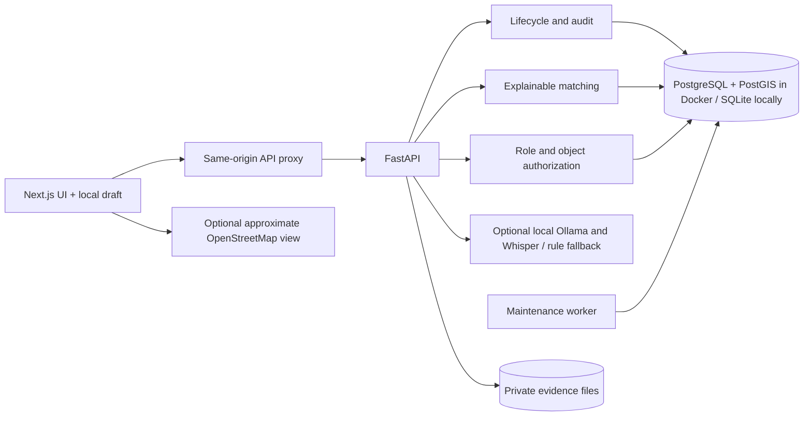
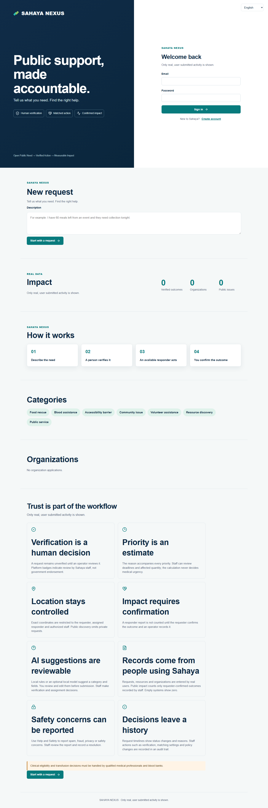

# Sahaya Nexus

**Open Public Need → Verified Action → Measurable Impact**

Sahaya Nexus coordinates food rescue, blood assistance, accessibility barriers, community issues, volunteering, resource discovery and public-service needs through one accountable workflow. A person submits a need; an operator verifies and prioritizes it; a verified responder acts; the requester checks the outcome; an operator records measured impact. There are no seeded people, requests, organizations, resources or outcomes.

## Run locally

Requirements: Python 3.12+, Node.js 22+, npm. Docker Desktop is needed for the PostgreSQL/PostGIS stack. No paid API key is required.

```powershell
cd backend
python -m venv .venv
.venv\Scripts\pip install -r requirements-dev.txt
.venv\Scripts\alembic upgrade head
.venv\Scripts\python -m app.cli create-admin
.venv\Scripts\uvicorn app.main:app --reload --host 127.0.0.1 --port 8000
```

In another terminal:

```powershell
cd frontend
npm ci
npm run dev
```

Open [http://localhost:3000](http://localhost:3000). For Docker, copy `.env.example` to `.env`, replace both secrets, run `docker compose up --build -d`, then create the first admin with `docker compose exec api python -m app.cli create-admin`. See [SETUP.md](SETUP.md) for details.

## Architecture



The browser never receives an API bearer token. Next.js keeps it in an HTTP-only, same-site cookie. Exact coordinates and evidence are restricted to the requester, assigned responder or authorized staff. Public map cells are aggregated and suppressed when too small.

## Working features

- Register, sign in, apply as a volunteer or register an organization; staff review identities and service claims.
- Verified organization owners can invite existing accounts inside the app; invited people must accept before gaining resource and assignment access. Owners can revoke access.
- Start a private text draft before sign-in, then describe a need in natural language or voice, inspect and edit the interpretation, add location and evidence, and submit.
- Move through a guarded state machine with reasoned verification, priority, explainable matching and assignment. PostGIS accelerates spatial candidate filtering in Docker.
- Responders accept, start, arrive and complete work. Citizens answer Yes, No or Partially. Impact counts only outcomes they confirmed and staff recorded.
- Manage resources with capacity, current workload, availability windows, expiry and service radius. A maintenance worker escalates overdue requests and expires food offers.
- Review capacity history for resource creation, organization edits, assignment reservations and releases.
- Search accessible records, browse opted-in verified public issues, see an aggregated impact map, save organizations, receive in-app notices and report abuse.
- Exchange request-scoped messages among the requester, assigned responder and authorized staff, with access checked on every read and send.
- Operators view the live queue, reviews, escalations, analytics, system health, audit trail, matching weights and platform policy.
- English, Hindi, Tamil and Malayalam dictionaries cover the main citizen flow and status labels. Keyboard focus, mobile layout, reduced motion, text size and contrast settings are provided.
- A service worker supplies an offline notice. A reviewed request that cannot reach the server stays on the device until the signed-in person explicitly sends or discards it after reconnection. Retry IDs prevent duplicate requests. The installable app remains usable with manual entry when AI or speech is unavailable.



## Real-data policy

No demo seed runs. This follows the explicit no-mock-data requirement, which supersedes the reference prompt's demo seed request. Tests use isolated databases and never populate the normal installation. An empty installation shows zero verified outcomes. The rule parser and manual form work without a local LLM.

## Verification

```powershell
cd backend
.venv\Scripts\ruff check app tests scripts --select E,F,I --ignore E501
.venv\Scripts\pytest -q
cd ..\frontend
npm run lint
npm run typecheck
npm run build
node scripts/check_public_responsive.mjs
node scripts/check_accessibility.mjs
```

The two browser audit scripts above read the local production page on port 3000. The accessibility audit checks WCAG A/AA rules in all four languages; it does not replace manual assistive-technology testing. Playwright write tests require an isolated frontend and an API with `APP_MODE=test`; see [SETUP.md](SETUP.md). `backend/scripts/postgis_smoke.py` is guarded to run only against a separate `sahaya_qa` database. The backend suite covers the full food rescue path, privacy boundaries, duplicate reports, evidence cleaning, escalation and anonymization.

## Production package

The [deployment guide](DEPLOYMENT.md) describes the HTTPS production Compose profile, configuration preflight, health checks and offline backup command. It has not been deployed publicly; launch still requires a real domain, an accountable operating organization and the release gates listed there.

## Limits

Sahaya is not an emergency dispatch service. It does not provide SMS/email delivery, clinical decision support, identity-document verification, background offline sync, malware scanning or automatic public-service directory sourcing. In-app notices are not push notifications. The speech model must be downloaded once, and OpenStreetMap tiles require a connection when map display is enabled. Some operator text and server-provided explanations remain English. No public deployment has been performed.

## Documentation

[Implementation status](STATUS.md) · [Architecture](ARCHITECTURE.md) · [Setup](SETUP.md) · [Data model](DATA_MODEL.md) · [API](API.md) · [AI](AI.md) · [Privacy](PRIVACY.md) · [Security](SECURITY.md) · [Real-data workflow](DEMO.md) · [Deployment](DEPLOYMENT.md) · [Contributing](CONTRIBUTING.md) · [Reference inspection](INSPECTION.md)
